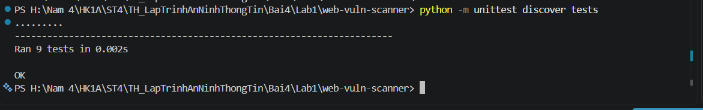
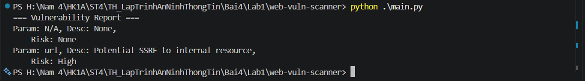
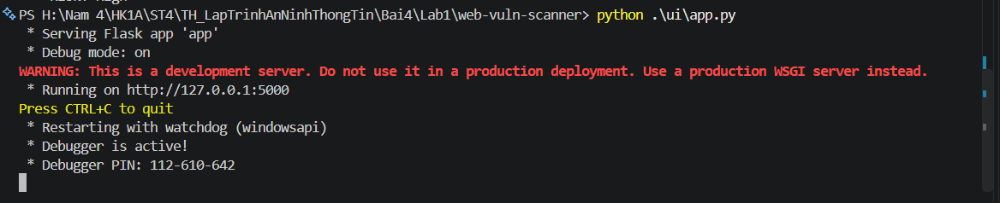
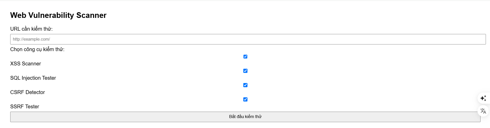
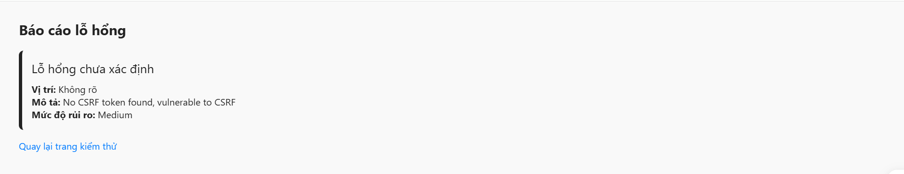

# BÁO CÁO BÀI TẬP THỰC HÀNH: LAB 1 - WEB VULNERABILITY SCANNER

> **Môn học:** Thực hành Lập trình An ninh Thông tin  
> **Chủ đề:** Xây dựng công cụ quét và phát hiện lỗ hổng bảo mật ứng dụng Web  
> **Mã nguồn:** `Lab1/web-vuln-scanner`

---

## 1. Giới thiệu & Mục tiêu

Ứng dụng **Web Vulnerability Scanner** là một công cụ kiểm thử an ninh bảo mật được xây dựng bằng ngôn ngữ Python, nhằm phát hiện sớm các lỗ hổng bảo mật web phổ biến thuộc danh mục **OWASP Top 10**.

### Mục tiêu đạt được:
- Xây dựng các module phát hiện tự động các nguy cơ bảo mật:
  - **XSS (Cross-Site Scripting):** Kiểm tra phản hồi có thực thi mã script hay không.
  - **SQL Injection (SQLi):** Thử nghiệm chèn các payload SQL vào tham số URL để tìm kiếm lỗi cơ sở dữ liệu.
  - **CSRF (Cross-Site Request Forgery):** Rà soát các thẻ biểu mẫu (form) HTML xem có tồn tại token chống giả mạo hay không.
  - **SSRF (Server-Side Request Forgery):** Phát hiện việc gọi URL trỏ đến các dải IP nội bộ, loopback (`127.0.0.1`, `localhost`, IP Private).
- Tạo báo cáo đánh giá rủi ro (Risk Assessment: Low, Medium, High).
- Cung cấp giao diện Web trực quan bằng **Flask Framework**.
- Đảm bảo chất lượng mã nguồn thông qua **Unit Tests** đạt chuẩn 100%.

---

## 2. Cấu trúc thư mục

```text
Lab1/web-vuln-scanner/
├── images/                   # Hình ảnh kết quả thực nghiệm
│   ├── image1.png            # Kết quả chạy Unit Tests
│   ├── image2.png            # Kết quả chạy script CLI main.py
│   ├── image3.png            # Khởi động Flask Server
│   ├── image4.png            # Giao diện chính của Web Scanner
│   └── image5.png            # Giao diện hiển thị kết quả quét lỗ hổng
├── report/
│   └── report_generator.py   # Module tổng hợp và phân loại rủi ro
├── scanners/
│   ├── csrf_detector.py      # Module phát hiện thiếu token CSRF
│   ├── sql_injection_tester.py # Module thử nghiệm lỗi SQL Injection
│   ├── ssrf_tester.py        # Module phát hiện nguy cơ SSRF nội bộ
│   └── xss_scanner.py        # Module kiểm tra XSS phản xạ
├── tests/                    # Thư mục chứa các kịch bản kiểm thử tự động
│   ├── test_csrf.py
│   ├── test_report.py
│   ├── test_sql_injection.py
│   ├── test_ssrf.py
│   └── test_xss.py
├── ui/
│   ├── templates/            # Giao diện HTML (index.html, result.html)
│   └── app.py                # Server Flask Web UI
├── main.py                   # Điểm khởi chạy dòng lệnh (CLI)
├── requirements.txt          # Danh sách thư viện phụ thuộc (Flask, requests)
└── README.md                 # Báo cáo thực hành chi tiết
```

---

## 3. Quá trình thực hiện & Minh chứng kết quả (Dựa trên mục `images/`)

Dưới đây là chi tiết các bước triển khai, kiểm thử và kết quả thực tế tương ứng với các ảnh minh chứng trong thư mục `images/`:

### Bước 1: Kiểm thử đơn vị tự động (Unit Testing)

Để kiểm chứng tính chính xác của các thuật toán quét lỗ hổng trước khi triển khai, tiến hành chạy toàn bộ các test case có trong thư mục `tests/` thông qua module `unittest`:

```powershell
python -m unittest discover tests
```


*Hình 1: Thực thi toàn bộ 9 test cases cho các scanner (XSS, SQLi, CSRF, SSRF, Report). Tất cả 9/9 tests đều vượt qua thành công (OK).*

- **Đánh giá:**
  - `test_xss.py`, `test_sql_injection.py`, `test_csrf.py`, `test_ssrf.py`, `test_report.py` đều hoạt động chính xác theo kịch bản giả lập (mock requests/payloads).
  - Tốc độ xử lý tức thời (~0.002s), đảm bảo tính ổn định của mã nguồn.

---

### Bước 2: Thực thi quét qua giao diện dòng lệnh (CLI Scanner)

Kiểm thử kịch bản quét thực tế với URL và HTML mẫu được định nghĩa sẵn trong file [main.py](main.py):

```powershell
python .\main.py
```


*Hình 2: Kết quả quét trên giao diện dòng lệnh (CLI) thông qua file main.py.*

- **Phân tích kết quả:**
  - URL thử nghiệm: `http://example.com/page?input=<script>alert(1)</script>&id=' OR '1'='1&url=http://127.0.0.1/admin`
  - Hệ thống tổng hợp báo cáo và phân loại rủi ro:
    - **Tham số `url`**: Phát hiện nguy cơ tấn công **SSRF** do truyền địa chỉ tài nguyên nội bộ `http://127.0.0.1/admin` (`Potential SSRF to internal resource`).
    - **Mức độ rủi ro:** Được đánh giá ở mức **High**.

---

### Bước 3: Khởi chạy dịch vụ Web UI (Flask Server)

Để người dùng dễ dàng thao tác kiểm thử trực quan trên trình duyệt, khởi chạy ứng dụng Flask tại thư mục `ui/`:

```powershell
python .\ui\app.py
```


*Hình 3: Khởi động thành công máy chủ phát triển Flask tại cổng 5000.*

- Server hoạt động ở chế độ `Debug mode: on` tại địa chỉ: `http://127.0.0.1:5000`.

---

### Bước 4: Giao diện nhập liệu và cấu hình quét

Truy cập trình duyệt tại `http://127.0.0.1:5000/` để vào giao diện chính:


*Hình 4: Giao diện trang chủ Web Vulnerability Scanner cho phép cấu hình tham số quét.*

- **Các chức năng chính trên giao diện:**
  1. **URL cần kiểm thử:** Cho phép người dùng nhập địa chỉ web mục tiêu cần quét an ninh.
  2. **Chọn công cụ kiểm thử (Tùy chọn đa mục tiêu):**
     - ☑ **XSS Scanner:** Quét lỗ hổng thực thi mã JavaScript phía máy khách.
     - ☑ **SQL Injection Tester:** Quét lỗ hổng tiêm mã SQL truy vấn cơ sở dữ liệu.
     - ☑ **CSRF Detector:** Quét kiểm tra cơ chế chống giả mạo yêu cầu chéo trang.
     - ☑ **SSRF Tester:** Quét kiểm tra việc giả mạo yêu cầu từ máy chủ vào mạng nội bộ.
  3. **Nút "Bắt đầu kiểm thử":** Gửi yêu cầu phân tích về server để kích hoạt các scanner đã chọn.

---

### Bước 5: Báo cáo kết quả lỗ hổng phát hiện được

Sau khi hoàn tất quá trình phân tích, hệ thống chuyển sang trang kết quả báo cáo:


*Hình 5: Trang hiển thị chi tiết các lỗ hổng bảo mật được phát hiện sau khi quét.*

- **Phân tích kết quả:**
  - **Lỗ hổng phát hiện:** Thiếu cơ chế phòng vệ CSRF (`No CSRF token found, vulnerable to CSRF`).
  - **Mức độ rủi ro:** `Medium`.
  - **Liên kết:** Cung cấp nút "Quay lại trang kiểm thử" để tiếp tục kiểm tra các mục tiêu khác.

---

## 4. Hướng dẫn chạy chương trình trong VS Code

### Yêu cầu môi trường
- Python 3.10+ (Đã thử nghiệm hoàn hảo trên Python 3.12).
- Các thư viện cần thiết:
  ```powershell
  pip install -r requirements.txt
  ```

### Các lệnh thực thi (Mở Terminal `Ctrl + ~` tại thư mục `web-vuln-scanner`):

1. **Chạy Unit Test:**
   ```powershell
   python -m unittest discover tests
   ```

2. **Chạy bản Console (CLI):**
   ```powershell
   python main.py
   ```

3. **Chạy bản Giao diện Web (Flask UI):**
   ```powershell
   python .\ui\app.py
   ```
   Sau đó mở trình duyệt truy cập: `http://127.0.0.1:5000/`.

---

## 5. Kết luận

- Bài thực hành đã hiện thực thành công công cụ phát hiện lỗ hổng bảo mật ứng dụng Web dạng mô-đun hóa cao, dễ mở rộng thêm các quy tắc quét mới.
- Báo cáo kết quả trực quan, phân định rõ mức độ nghiêm trọng giúp lập trình viên và kiểm thử viên nắm bắt nhanh nguy cơ để vá lỗi kịp thời.
- Toàn bộ các bước kiểm thử chức năng và giao diện đều đạt yêu cầu và được ghi nhận đầy đủ qua các hình ảnh minh chứng trong thư mục `images/`.
