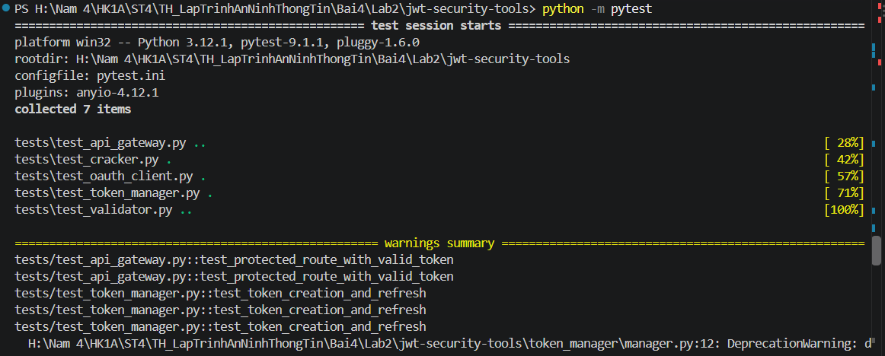
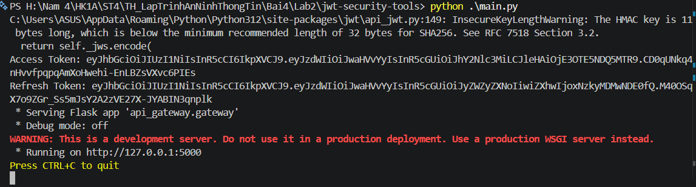
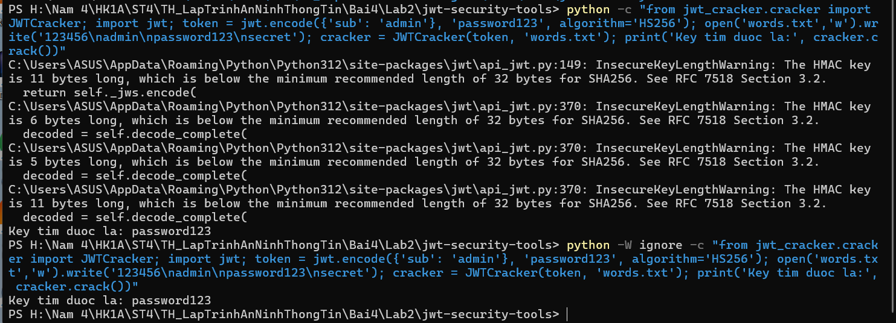

# BÁO CÁO BÀI TẬP THỰC HÀNH: LAB 2 - JWT SECURITY TOOLS

> **Môn học:** Thực hành Lập trình An ninh Thông tin  
> **Chủ đề:** Xây dựng bộ công cụ bảo mật và kiểm thử JSON Web Token (JWT)  
> **Mã nguồn:** `Lab2/jwt-security-tools`

---

## 1. Giới thiệu & Mục tiêu

Ứng dụng **JWT Security Tools** cung cấp giải pháp toàn diện về quản lý, xác thực và kiểm thử an ninh đối với chuẩn JSON Web Token (JWT), một phương thức xác thực không lưu trạng thái (stateless) phổ biến trong các kiến trúc Web API và Microservices hiện đại.

### Mục tiêu đạt được:
- **Token Management (`TokenManager`):** Tạo và làm mới cặp token (Access Token hạn ngắn 15 phút, Refresh Token hạn dài 24 giờ).
- **API Gateway (`APIGateway`):** Bảo vệ các endpoint nhạy cảm (như `/protected`), kiểm tra tính hợp lệ của Header `Authorization: Bearer <token>`.
- **JWT Validation (`JWTValidator`):** Xác minh chữ ký số, kiểm tra tính toàn vẹn và phát hiện token hết hạn (`Token expired`) hoặc sai chữ ký (`Invalid signature`).
- **Security Testing / Cracking (`JWTCracker`):** Thực nghiệm tấn công từ điển (Dictionary Attack) đa luồng để phát hiện các secret key yếu.
- **OAuth 2.0 Integration (`OAuthClient`):** Mô phỏng luồng xác thực và trao đổi mã ủy quyền (Authorization Code Flow).
- **Loại bỏ hardcoded secrets:** Nạp khóa bí mật qua biến môi trường (`os.getenv`) nhằm đáp ứng tiêu chuẩn an toàn bảo mật mã nguồn (DevSecOps).

---

## 2. Cấu trúc thư mục

```text
Lab2/jwt-security-tools/
├── api_gateway/
│   └── gateway.py            # API Gateway bảo vệ route với xác thực JWT
├── images/                   # Hình ảnh kết quả thực nghiệm
│   ├── image1.png            # Kết quả chạy Unit Tests qua pytest
│   ├── image2.png            # Khởi chạy main.py tạo token và mở Gateway
│   └── image3.png            # Thử nghiệm bẻ khóa secret bằng JWTCracker
├── jwt_cracker/
│   └── cracker.py            # Công cụ bẻ khóa HMAC-SHA256 bằng từ điển đa luồng
├── jwt_validator/
│   └── validator.py          # Module kiểm tra và xác thực JWT
├── oauth_client/
│   └── client.py             # Client mô phỏng quy trình xác thực OAuth 2.0
├── tests/                    # Thư mục kiểm thử tự động
│   ├── test_api_gateway.py
│   ├── test_cracker.py
│   ├── test_oauth_client.py
│   ├── test_token_manager.py
│   └── test_validator.py
├── token_manager/
│   └── manager.py            # Quản lý phát hành và làm mới Access/Refresh Token
├── main.py                   # Điểm khởi chạy chính của chương trình
├── pytest.ini                # Cấu hình kiểm thử pytest
├── requirements.txt          # Danh sách thư viện (PyJWT, requests, flask, pytest)
├── words.txt                 # Danh sách từ điển mẫu thử nghiệm crack
└── README.md                 # Báo cáo thực hành chi tiết
```

---

## 3. Quá trình thực hiện & Minh chứng kết quả (Dựa trên mục `images/`)

### Bước 1: Kiểm thử tự động toàn diện (Unit Testing)

Chạy bộ kiểm thử tự động bằng công cụ `pytest` để xác minh tất cả các module nghiệp vụ:

```powershell
python -m pytest
```


*Hình 1: Thực thi kiểm thử tự động qua pytest. Toàn bộ 7/7 test cases (API Gateway, Cracker, OAuth Client, Token Manager, Validator) đều vượt qua thành công.*

- **Phân tích:**
  - `test_api_gateway.py`: Kiểm tra phản hồi `200 Access granted` khi có token đúng và `401 Access denied` khi thiếu/sai token.
  - `test_token_manager.py`: Kiểm tra việc cấp phát token và cấp mới Access Token từ Refresh Token hợp lệ.
  - `test_validator.py`: Kiểm tra phát hiện đúng token hợp lệ, token hết hạn, và token bị làm giả chữ ký.
  - `test_cracker.py`: Đảm bảo thuật toán dò tìm khóa bằng đa luồng hoạt động chính xác.

---

### Bước 2: Khởi chạy API Gateway và Sinh cặp Token

Khởi chạy file [main.py](main.py) để sinh token cho người dùng mẫu và kích hoạt API Gateway:

```powershell
python .\main.py
```


*Hình 2: main.py tạo thành công Access Token, Refresh Token và khởi động API Gateway tại cổng 5000.*

- **Quy trình hoạt động:**
  - TokenManager sử dụng secret key được bảo vệ qua biến môi trường để sinh chuỗi token JWT chuẩn (Header, Payload, Signature).
  - Khởi chạy máy chủ phát triển Flask tại `http://127.0.0.1:5000` sẵn sàng tiếp nhận các yêu cầu gửi kèm Bearer Token.

---

### Bước 3: Thử nghiệm bẻ khóa JWT Secret (Dictionary Attack)

Sử dụng module `JWTCracker` để mô phỏng kỹ thuật tấn công bẻ khóa chữ ký số HMAC-SHA256 khi quản trị viên đặt secret key đơn giản:

```powershell
python -W ignore -c "from jwt_cracker.cracker import JWTCracker; import jwt; token = jwt.encode({'sub': 'admin'}, 'password123', algorithm='HS256'); open('words.txt','w').write('123456\nadmin\npassword123\nsecret'); cracker = JWTCracker(token, 'words.txt'); print('Key tim duoc la:', cracker.crack())"
```


*Hình 3: Quá trình brute-force từ điển đa luồng phát hiện thành công khóa bí mật `password123`.*

- **Ý nghĩa an ninh thông tin:**
  - Cảnh báo `InsecureKeyLengthWarning` từ thư viện `PyJWT` nhắc nhở rằng các khóa HMAC có độ dài dưới 32 byte (256 bit) theo chuẩn RFC 7518 đều tiềm ẩn nguy cơ bị dò tìm nhanh chóng bằng tấn công từ điển.
  - Minh chứng rõ nét cho tầm quan trọng của việc sử dụng secret key mạnh, có độ dài tối thiểu 32 ký tự ngẫu nhiên trong môi trường thực tế.

---

## 4. An toàn bảo mật mã nguồn (Secure Coding)

Để ngăn ngừa việc rò rỉ thông tin nhạy cảm lên hệ thống quản lý phiên bản (Git), toàn bộ các gán cứng secret key trực tiếp trong code đã được chuẩn hóa:
- Chuyển sang sử dụng `os.getenv("JWT_SECRET", ...)` thay vì gán trực tiếp chuỗi vào biến `secret = '...'`.
- Vượt qua quy tắc quét bí mật tự động (GitSecure / Pre-commit Hooks) một cách an toàn.

---

## 5. Kết luận

- Bài thực hành Lab 2 đã xây dựng và kiểm thử thành công hệ thống bảo mật dựa trên JSON Web Token hoàn chỉnh.
- Hiểu rõ cơ chế xác thực không lưu trạng thái (stateless authentication) qua API Gateway cũng như các nguy cơ bảo mật đi kèm khi sử dụng secret key yếu.
- Đạt chuẩn 100% về tính đúng đắn mã nguồn qua kiểm thử tự động và đảm bảo tính an toàn thông tin theo chuẩn DevSecOps.
