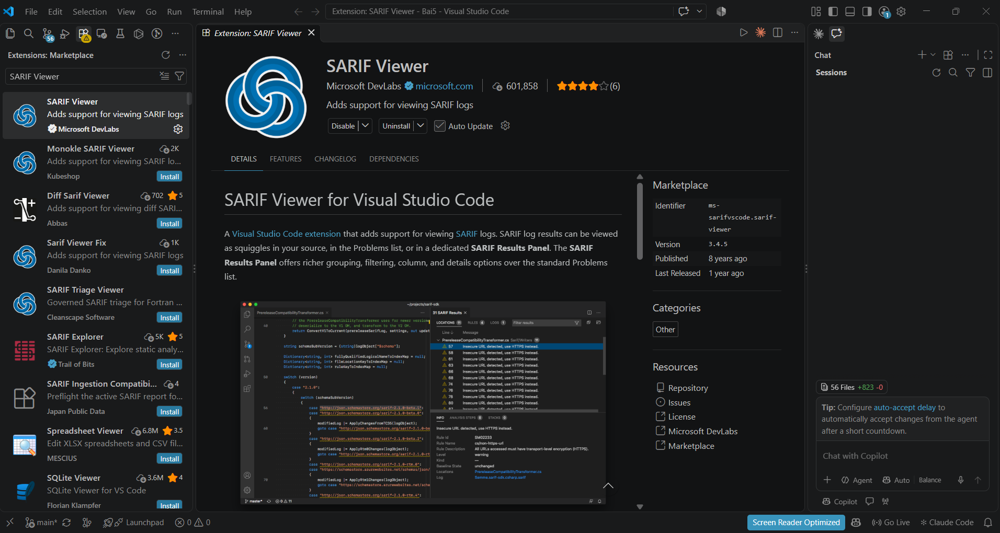
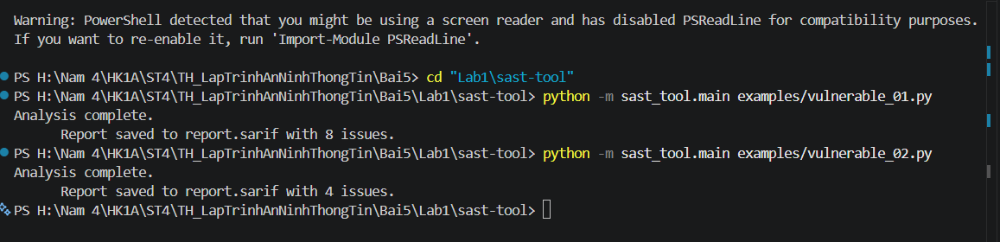
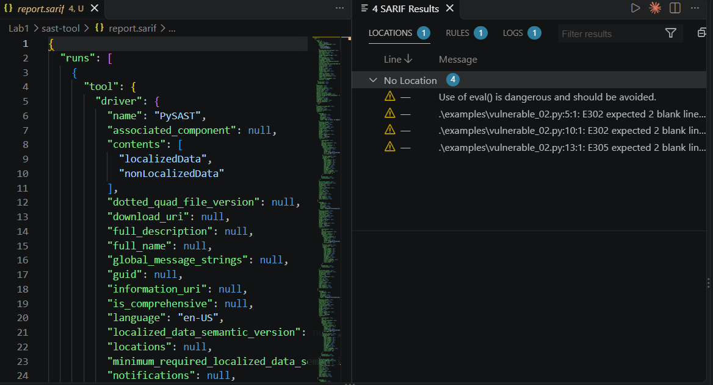
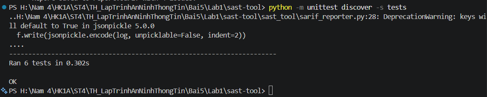

# BÁO CÁO THỰC HÀNH LAB 1: XÂY DỰNG VÀ THỰC THI CÔNG CỤ SAST (STATIC APPLICATION SECURITY TESTING)

Dự án này triển khai một công cụ phân tích tĩnh mã nguồn Python (**PySAST**) nhằm phát hiện sớm các lỗ hổng bảo mật tiềm ẩn và kiểm tra chất lượng mã nguồn, sau đó xuất báo cáo theo định dạng chuẩn công nghiệp **SARIF (Static Analysis Results Interchange Format)**.

---

## 1. Cấu trúc thư mục Lab 1

```text
Lab1/
└── sast-tool/
    ├── examples/                  # Mã nguồn mẫu dùng để kiểm thử quét lỗ hổng
    │   ├── vulnerable_01.py
    │   └── vulnerable_02.py
    ├── images/                    # Hình ảnh minh chứng các bước thực hành
    │   ├── image1.png
    │   ├── image2.png
    │   ├── image3.png
    │   └── image4.png
    ├── rules/                     # Tập luật phát hiện lỗ hổng
    │   └── default_rules.json
    ├── sast_tool/                 # Module mã nguồn chính của công cụ SAST
    │   ├── __init__.py
    │   ├── ast_analyzer.py        # Phân tích cú pháp trừu tượng (AST)
    │   ├── vuln_pattern_matcher.py # Khớp mẫu lỗ hổng qua biểu thức chính quy (Regex)
    │   ├── code_quality_checker.py # Kiểm tra quy chuẩn chất lượng code (Flake8)
    │   ├── security_rule_engine.py # Động cơ xử lý và đánh giá quy tắc bảo mật
    │   ├── sarif_reporter.py      # Sinh báo cáo chuẩn SARIF
    │   └── main.py                # Điểm khởi chạy CLI của công cụ
    ├── tests/                     # Bộ kiểm thử tự động (Unit Tests)
    │   ├── test_ast_analyzer.py
    │   ├── test_code_quality_checker.py
    │   ├── test_sarif_reporter.py
    │   ├── test_security_rule_engine.py
    │   └── test_vuln_pattern_matcher.py
    ├── requirements.txt           # Danh sách các thư viện phụ thuộc
    └── report.sarif               # Báo cáo kết quả quét định dạng SARIF
```

---

## 2. Chuẩn bị môi trường & Cài đặt

1. Mở Terminal trong VSCode, di chuyển vào thư mục dự án:
   ```powershell
   cd "Lab1\sast-tool"
   ```

2. Tạo và kích hoạt môi trường ảo Python *(khuyến nghị)*:
   ```powershell
   python -m venv .venv
   .\.venv\Scripts\Activate.ps1
   ```

3. Cài đặt các gói thư viện cần thiết:
   ```powershell
   pip install -r requirements.txt
   ```
   *Các phụ thuộc chính:* `flake8`, `sarif-om`, `jsonpickle`.

---

## 3. Các bước thực hiện & Kết quả thực hành (Dựa trên ảnh minh chứng)

### Bước 1: Cài đặt extension SARIF Viewer trên VSCode
Để hiển thị trực quan các cảnh báo an ninh từ file báo cáo `.sarif` ngay trên giao diện soạn thảo code:
- Mở **Extensions Marketplace** trên VSCode (`Ctrl + Shift + X`).
- Tìm kiếm từ khóa `SARIF Viewer`.
- Chọn extension **SARIF Viewer** do **Microsoft DevLabs** phát triển và nhấn **Install**.



---

### Bước 2: Chạy công cụ quét bảo mật tĩnh (SAST Tool)
Thực thi công cụ phân tích trên các tệp mã nguồn mẫu trong thư mục `examples`:

1. **Quét file mẫu `vulnerable_01.py`:**
   ```powershell
   python -m sast_tool.main examples/vulnerable_01.py
   ```
   *Kết quả:* Phát hiện **8 vấn đề** (issues) và xuất báo cáo vào file `report.sarif`.

2. **Quét file mẫu `vulnerable_02.py`:**
   ```powershell
   python -m sast_tool.main examples/vulnerable_02.py
   ```
   *Kết quả:* Phát hiện **4 vấn đề** (issues) và cập nhật báo cáo vào file `report.sarif`.



---

### Bước 3: Xem và phân tích kết quả báo cáo SARIF
Mở file `report.sarif` vừa được sinh ra. Bảng điều khiển **SARIF Results** trong VSCode sẽ phân loại và hiển thị chi tiết các lỗi:
- **Lỗ hổng an ninh nguy hiểm:** Cảnh báo sử dụng hàm `eval()` nguy hiểm (`Use of eval() is dangerous and should be avoided.`).
- **Vi phạm tiêu chuẩn code (Code Quality):** Các cảnh báo vi phạm quy chuẩn PEP 8 do `flake8` phát hiện (ví dụ: `E302 expected 2 blank lines`, `E305 expected 2 blank lines`).



---

### Bước 4: Chạy kiểm thử tự động (Unit Tests)
Thực hiện chạy toàn bộ các bài unit test để kiểm tra tính toàn vẹn và độ tin cậy của các module trong công cụ SAST:
```powershell
python -m unittest discover -s tests
```
*Kết quả:* Toàn bộ **6/6 bài test** đều vượt qua thành công (**OK**).



---

## 4. Tổng kết đánh giá

- Công cụ **PySAST** đã kết hợp thành công:
  1. **AST Analysis**: Bắt được lời gọi các hàm nguy hiểm ở mức cây cú pháp (`eval`, `exec`).
  2. **Pattern Matching**: Quét regex tìm các mẫu chuỗi nhạy cảm hoặc nguy hiểm.
  3. **Linter & Code Quality**: Tích hợp Flake8 kiểm tra chuẩn mã nguồn.
  4. **SARIF Integration**: Chuẩn hóa đầu ra giúp dễ dàng tích hợp vào IDE (VSCode) và các luồng CI/CD DevSecOps.
- Toàn bộ các module hoạt động ổn định và vượt qua bộ kiểm thử tự động.
