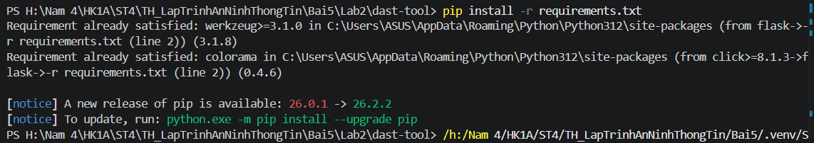
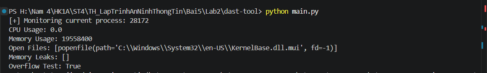
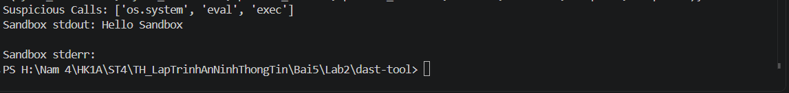
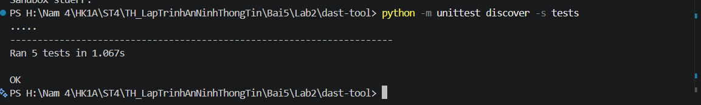
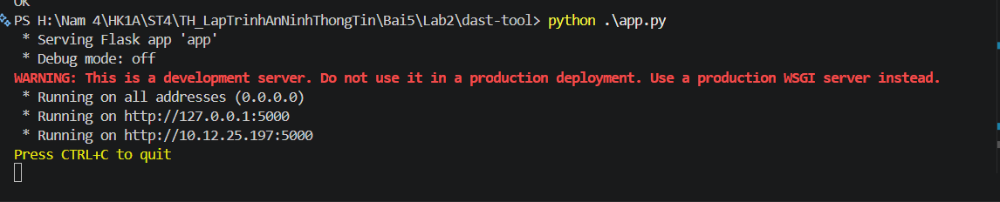

# BÁO CÁO THỰC HÀNH LAB 2: XÂY DỰNG VÀ THỰC THI CÔNG CỤ DAST (DYNAMIC APPLICATION SECURITY TESTING)

Dự án này triển khai một công cụ kiểm thử an ninh ứng dụng động (**DAST Tool**) bằng ngôn ngữ Python, cho phép giám sát tiến trình trong thời gian chạy (runtime), phân tích bộ nhớ, thống kê lưu lượng mạng, phát hiện hành vi gọi hàm nguy hiểm và thực thi lệnh trong môi trường cô lập (Sandbox). Công cụ hỗ trợ cả giao diện dòng lệnh (CLI), bộ kiểm thử tự động (Unit Tests) và dịch vụ Web API (Flask RESTful API).

---

## 1. Cấu trúc thư mục Lab 2

```text
Lab2/
└── dast-tool/
    ├── images/                          # Hình ảnh minh chứng các bước thực hành
    │   ├── image1.png                   # Cài đặt thư viện phụ thuộc
    │   ├── image2.png                   # Chạy phân tích DAST CLI (Phần 1)
    │   ├── image3.png                   # Chạy phân tích DAST CLI (Phần 2)
    │   ├── image4.png                   # Chạy Unit Tests tự động
    │   └── image5.png                   # Khởi chạy Flask Web API
    ├── tests/                           # Bộ kiểm thử tự động (Unit Tests)
    │   ├── __init__.py
    │   ├── test_memory_analyzer.py
    │   ├── test_network_traffic_analyzer.py
    │   ├── test_runtime_monitor.py
    │   ├── test_security_behavior_checker.py
    │   └── test_virtual_sandbox.py
    ├── app.py                           # Dịch vụ Web API cung cấp các endpoint giám sát (Flask)
    ├── main.py                          # Chương trình chính chạy qua giao diện dòng lệnh (CLI)
    ├── memory_analyzer.py               # Phân tích rò rỉ bộ nhớ và kiểm tra tràn số (Overflow)
    ├── network_traffic_analyzer.py      # Giám sát thông số truyền nhận mạng qua psutil
    ├── runtime_monitor.py               # Giám sát tiến trình thời gian thực (CPU, RAM, Open Files)
    ├── security_behavior_checker.py     # Phát hiện các hàm nhạy cảm/nguy hiểm (os.system, eval, exec)
    ├── virtual_sandbox.py               # Môi trường cô lập thực thi lệnh an toàn (Sandbox)
    └── requirements.txt                 # Danh sách thư viện phụ thuộc (psutil, flask)
```

---

## 2. Chuẩn bị môi trường & Cài đặt

1. Mở Terminal trong VSCode, di chuyển vào thư mục dự án `dast-tool`:
   ```powershell
   cd "Lab2\dast-tool"
   ```

2. Cài đặt các gói thư viện cần thiết:
   ```powershell
   pip install -r requirements.txt
   ```
   *Các thư viện chính:*
   - `psutil`: Truy xuất thông tin tiến trình và phần cứng hệ thống (CPU, RAM, Open files, Network IO).
   - `flask`: Xây dựng máy chủ Web API phục vụ giám sát từ xa.

---

## 3. Các bước thực hiện & Kết quả thực hành (Dựa trên ảnh minh chứng)

### Bước 1: Cài đặt các thư viện phụ thuộc
Thực hiện cài đặt các thư viện được chỉ định trong `requirements.txt`:
```powershell
pip install -r requirements.txt
```
*Kết quả:* Các gói thư viện phụ thuộc đã được tải và cài đặt thành công vào môi trường Python.



---

### Bước 2: Chạy công cụ DAST qua giao diện dòng lệnh (CLI)
Thực thi file `main.py` để phân tích và đánh giá hành vi tiến trình hiện tại:
```powershell
python main.py
```

*Kết quả phân tích:*
- **Tiến trình theo dõi (PID):** Xác định mã định danh PID của tiến trình hiện tại.
- **Tài nguyên sử dụng:** Đo lường mức sử dụng CPU (`CPU Usage: 0.0`), bộ nhớ RAM tiêu thụ (`Memory Usage`) và danh sách tệp tin đang mở (`Open Files`).
- **Phân tích bộ nhớ:** Bộ thu gom rác xác nhận không có đối tượng rò rỉ bộ nhớ (`Memory Leaks: []`) và kiểm tra điều kiện tràn số (`Overflow Test: True`).



- **Phát hiện hành vi đáng ngờ (Security Behavior):** Bắt được các lời gọi hàm nguy hiểm trong mã nguồn gồm `os.system`, `eval`, `exec`.
- **Thực thi trong Virtual Sandbox:** Chạy thử nghiệm lệnh an toàn `echo Hello Sandbox` trong thư mục tạm cô lập, ghi nhận thành công chuỗi xuất chuẩn (`Sandbox stdout: Hello Sandbox`).



---

### Bước 3: Chạy bộ kiểm thử tự động (Unit Tests)
Thực thi kiểm thử toàn bộ 5 module chức năng trong thư mục `tests`:
```powershell
python -m unittest discover -s tests
```
*Kết quả:* Toàn bộ **5/5 test cases** đều chạy thành công trong `1.067s` (**OK**), xác nhận tính chính xác và ổn định của các module:
- `test_runtime_monitor`: Kiểm tra đọc chỉ số CPU và RAM.
- `test_memory_analyzer`: Kiểm tra phân tích bộ nhớ và tràn số.
- `test_network_traffic_analyzer`: Kiểm tra đọc số liệu mạng.
- `test_security_behavior_checker`: Kiểm tra phát hiện hàm nguy hiểm.
- `test_virtual_sandbox`: Kiểm tra thực thi lệnh cô lập.



---

### Bước 4: Khởi chạy dịch vụ Web API giám sát động (Flask Server)
Triển khai công cụ dưới dạng dịch vụ Web API để cho phép các hệ thống giám sát khác truy xuất dữ liệu kiểm tra từ xa:
```powershell
python .\app.py
```
*Kết quả:* Flask Development Server khởi chạy thành công và lắng nghe yêu cầu tại cổng `5000` (`http://127.0.0.1:5000`):



Các endpoint API sẵn sàng phục vụ:
- `GET /api/monitor`: Lấy thông số CPU, RAM và tập tin đang mở.
- `GET /api/memory`: Lấy kết quả phân tích bộ nhớ và tràn số.
- `GET /api/network`: Thống kê gói tin mạng gửi/nhận.
- `GET /api/security`: Báo cáo danh sách các cuộc gọi hàm nguy hiểm.
- `POST /api/sandbox`: Gửi lệnh cần thực thi an toàn trong Sandbox dưới định dạng JSON (`{"command": "<lệnh>"}`).

---

## 4. Tổng kết đánh giá

- **Tính toàn diện:** Công cụ DAST đã hoàn thành xuất sắc các tác vụ kiểm thử động ở mức tiến trình runtime, bộ nhớ, mạng và cô lập thực thi.
- **Tính khả chuyển:** Vừa hỗ trợ chạy nhanh qua CLI, vừa có REST API linh hoạt phục vụ tích hợp tự động hóa trong quy trình an toàn thông tin DevSecOps.
- Toàn bộ các module vượt qua 100% các bài kiểm thử tự động.
