# BÁO CÁO THỰC HÀNH BÀI 6: BẢO MẬT VỚI DEVSECOPS – THỰC HÀNH CI/CD VỚI GITLAB

**Môn học:** Lập trình An ninh Thông tin  
**Bài thực hành:** Bài 6 - Bảo mật với DevSecOps  
**Nội dung:** Thiết lập, cấu hình và vận hành hệ thống CI/CD Pipeline tự động trên GitLab (`6.2.1` & `6.2.2`)  

---

## 1. MỤC TIÊU BÀI THỰC HÀNH
- Hiểu rõ vai trò của **CI/CD (Continuous Integration / Continuous Delivery & Deployment)** trong quy trình **DevSecOps**.
- Nắm vững cấu trúc tệp cấu hình `.gitlab-ci.yml`, cách định nghĩa các giai đoạn (**stages**), công việc (**jobs**), kịch bản thực thi (**script**), biến môi trường định sẵn (`$GITLAB_USER_LOGIN`, `$CI_COMMIT_BRANCH`) và cơ chế lưu trữ kết quả trung gian (**artifacts**).
- Thực hành khởi tạo kho lưu trữ trên **GitLab.com**, kích hoạt **GitLab Runner**, theo dõi trạng thái thực thi và kiểm tra nhật ký (**Job logs**) của từng tác vụ trong pipeline.
- Xây dựng pipeline CI/CD nhiều giai đoạn kết hợp Docker container (`image: node`) để tự động hóa quá trình đóng gói (`build`) và triển khai (`deploy`) ứng dụng web tĩnh **Docusaurus** lên **GitLab Pages**.

---

Link gitlab: https://gitlab.com/devsecops-lab2981744/lam-pipeline-tutorial-project

## 2. CẤU TRÚC THƯ MỤC BÀI 6

```text
Bai6/
├── images/
│   ├── 6.2.1/                         # Hình ảnh minh chứng Bài 6.2.1 (Tạo và chạy CI/CD pipeline)
│   │   ├── image1.png
│   │   ├── image2.png
│   │   ├── image3.png
│   │   ├── image4.png
│   │   ├── image5.png
│   │   ├── image6.png
│   │   ├── image7.png
│   │   ├── image8.png
│   │   ├── image9.png
│   │   ├── image10.png
│   │   ├── image11.png
│   │   ├── image12.png
│   │   └── image13.png
│   └── 6.2.2/                         # Hình ảnh minh chứng Bài 6.2.2 (Tạo pipeline CI/CD phức tạp)
│       ├── image1.png
│       ├── image2.png
│       ├── image3.png
│       └── image4.png
├── pipeline-tutorial/                 # Mã nguồn dự án Docusaurus (Bài 6.2.2)
│   ├── blog/
│   ├── docs/
│   ├── src/
│   ├── static/
│   ├── .gitlab-ci.yml                 # Cấu hình pipeline build & deploy GitLab Pages
│   ├── docusaurus.config.js           # Cấu hình URL và baseUrl cho GitLab Pages
│   ├── package.json
│   └── README.md
└── README.md                          # Báo cáo chi tiết các bước thực hành Bài 6
```

---

## 3. NỘI DUNG THỰC HÀNH 6.2.1: TẠO VÀ CHẠY CI/CD PIPELINE

### Bước 1: Thiết lập môi trường và khởi tạo dự án trên GitLab
1. Đăng nhập vào **GitLab.com** và thiết lập thông tin không gian làm việc ban đầu:
   - **Company name:** `HUTECH`
   - **Group name:** `devsecops-lab`
   - **Project name:** `devsecops-lab06`
   - **Role:** `DevOps Engineer`

   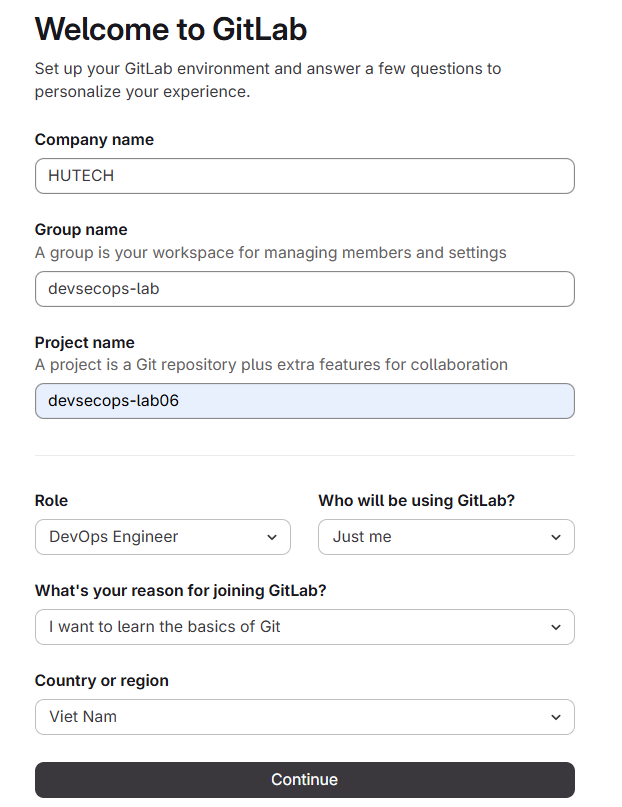
   *Hình 1: Thiết lập thông tin tổ chức và nhóm làm việc ban đầu trên GitLab.*

2. Trong nhóm `devsecops-lab`, chọn **New project** -> **Create blank project** để tạo một kho lưu trữ trống mới.

   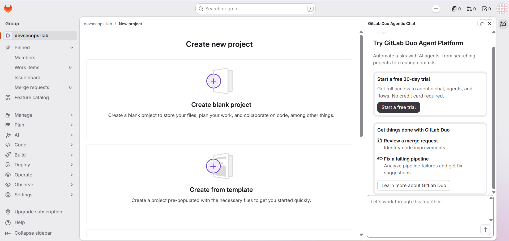
   *Hình 2: Chọn tính năng tạo dự án trống (Create blank project).*

3. Nhập thông tin chi tiết cho dự án:
   - **Project name:** `devsecops-lab6`
   - **Project URL:** `https://gitlab.com/devsecops-lab2981744/devsecops-lab6`
   - **Visibility Level:** `Private`
   - **Project Configuration:** Tích chọn **Initialize repository with a README**, sau đó nhấn **Create project**.

   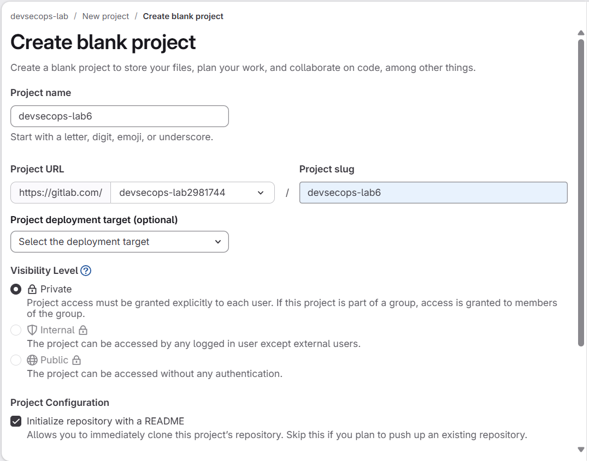
   *Hình 3: Điền thông tin cấu hình cho dự án `devsecops-lab6`.*

4. Sau khi khởi tạo thành công, giao diện tổng quan của kho lưu trữ `devsecops-lab6` hiển thị nhánh mặc định `main` cùng tệp `README.md`.

   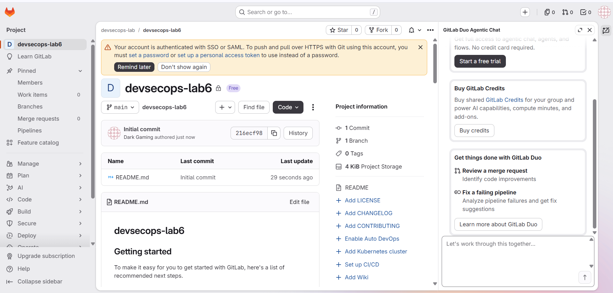
   *Hình 4: Kho lưu trữ `devsecops-lab6` được khởi tạo thành công.*

---

### Bước 2: Tạo tệp cấu hình `.gitlab-ci.yml`
1. Tại trang kho lưu trữ (**Code > Repository**), kiểm tra nhánh đang chọn là `main`, nhấn vào biểu tượng dấu cộng (`+`) và chọn **New file** dưới mục *This directory*.

   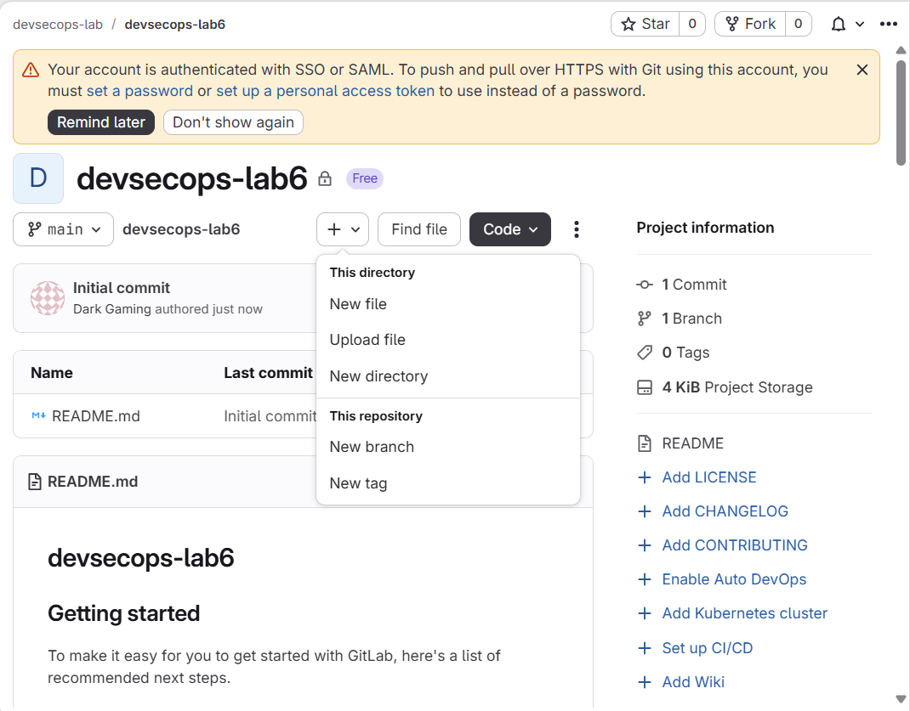
   *Hình 5: Chọn dấu cộng (+) > New file để thêm tệp cấu hình vào thư mục gốc.*

2. Giao diện trình soạn thảo **New file** mở ra trên nhánh `main`.

   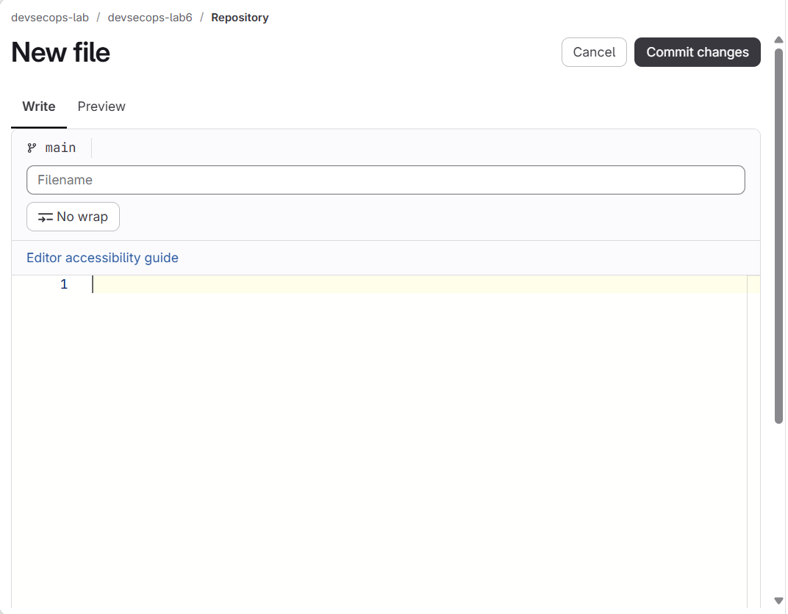
   *Hình 6: Giao diện trình soạn thảo tệp mới trên GitLab.*

3. Tại ô **Filename**, nhập `.gitlab-ci.yml` và dán đoạn mã cấu hình pipeline gồm 4 công việc (`build-job`, `test-job1`, `test-job2`, `deploy-prod`) tương ứng với 3 giai đoạn (`build`, `test`, `deploy`):

   ```yaml
   build-job:
     stage: build
     script:
       - echo "Hello, $GITLAB_USER_LOGIN!"

   test-job1:
     stage: test
     script:
       - echo "This job tests something"

   test-job2:
     stage: test
     script:
       - echo "This job tests something, but takes more time than test-job1."
       - sleep 20

   deploy-prod:
     stage: deploy
     script:
       - echo "This job deploys something from the $CI_COMMIT_BRANCH branch."
     environment: production
   ```

   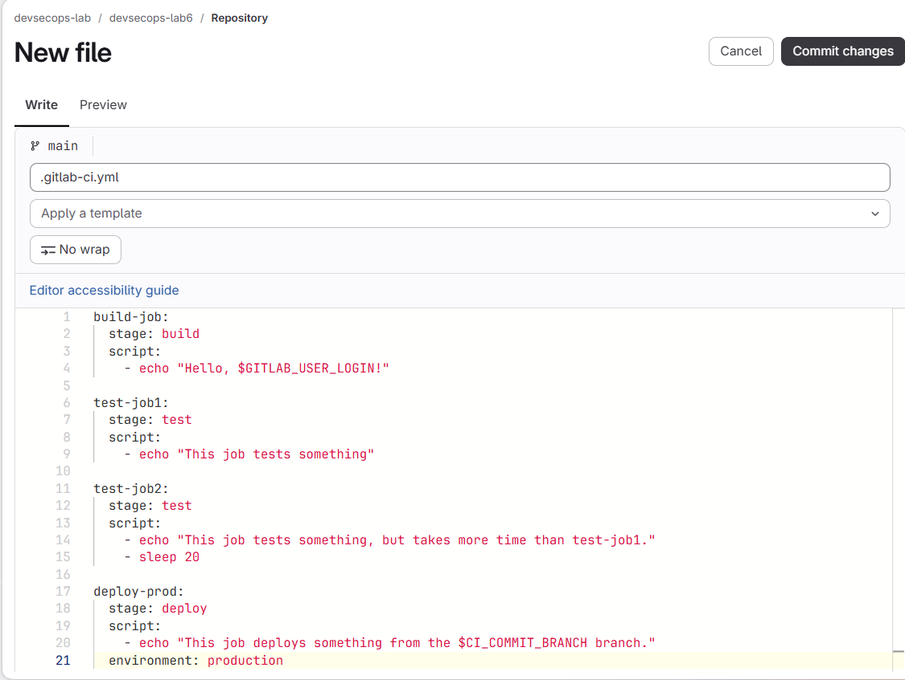
   *Hình 7: Đặt tên tệp `.gitlab-ci.yml` và nhập nội dung định nghĩa các job.*

4. Nhấn nút **Commit changes** ở góc trên bên phải. Trong hộp thoại xác nhận, nhập thông điệp commit (`Add new file`), chọn **Commit to the current `main` branch** và nhấn **Commit changes**.

   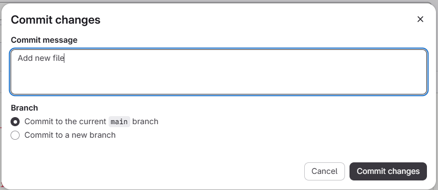
   *Hình 8: Xác nhận commit tệp `.gitlab-ci.yml` vào nhánh `main`.*

5. Hệ thống thông báo tệp `.gitlab-ci.yml` đã được tạo thành công (`The file has been successfully created.`).

   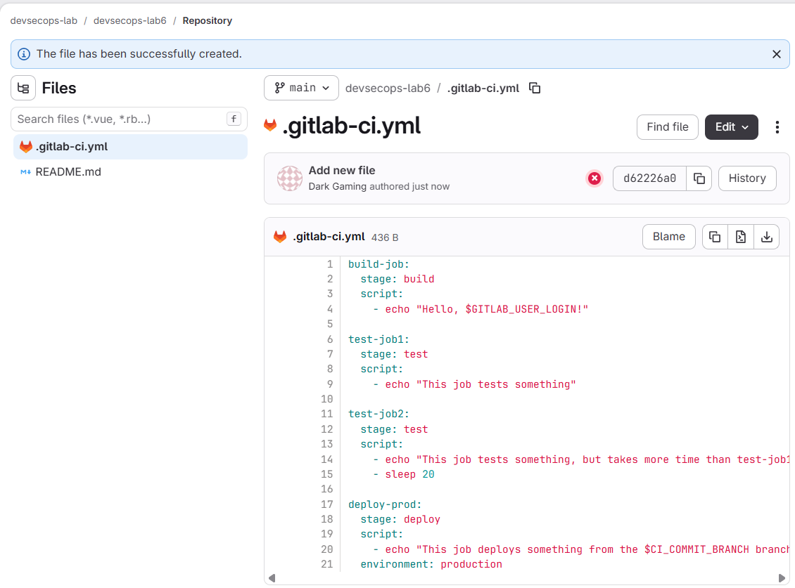
   *Hình 9: Tệp `.gitlab-ci.yml` đã được lưu vào kho lưu trữ.*

---

### Bước 3: Kiểm tra trạng thái của Pipeline và các công việc (Jobs)
1. Truy cập **Build > Pipeline editor** ở thanh menu bên trái để kiểm tra tính hợp lệ của cú pháp YAML và trạng thái thực thi. Hệ thống báo `Pipeline syntax is correct` và `Pipeline #2997084553 passed` với cả 3 giai đoạn đều hoàn tất.

   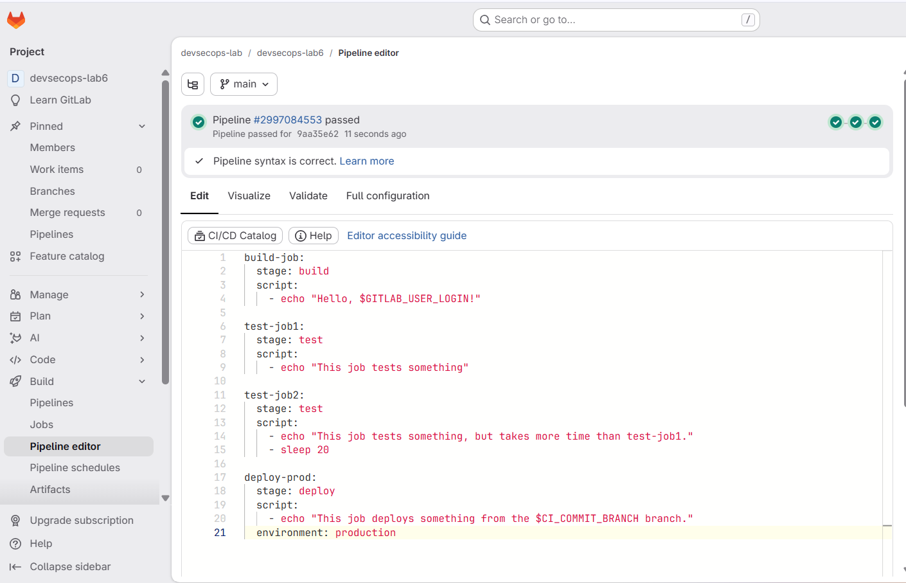
   *Hình 10: Kiểm tra cú pháp và trạng thái pipeline trong Pipeline editor.*

2. Đi đến **Build > Pipelines** để xem danh sách các lần chạy pipeline. Pipeline `#2997084553` hiển thị trạng thái **Passed** cùng 3 dấu tích xanh đại diện cho 3 stage (`build`, `test`, `deploy`).

   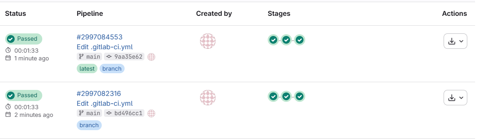
   *Hình 11: Trạng thái Passed của pipeline trong danh sách Build > Pipelines.*

3. Nhấn vào mã ID của pipeline (`#2997084553`) để xem sơ đồ trực quan hóa luồng thực thi:
   - **Stage `build`:** `build-job` hoàn thành thành công.
   - **Stage `test`:** `test-job1` và `test-job2` chạy song song và đều hoàn thành thành công.
   - **Stage `deploy`:** `deploy-prod` chạy sau khi stage `test` hoàn tất và đạt trạng thái thành công.

   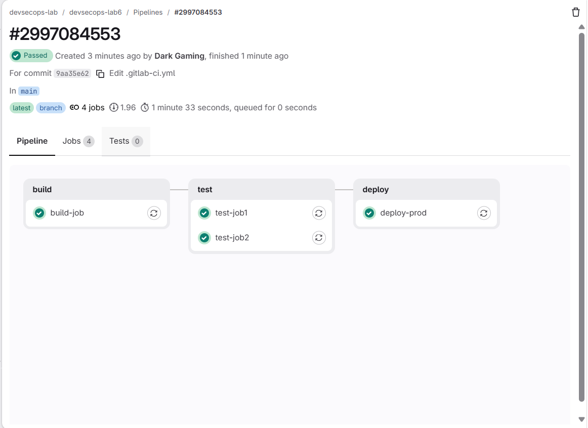
   *Hình 12: Sơ đồ trực quan 3 giai đoạn và 4 công việc của Pipeline `#2997084553`.*

4. Nhấn vào tên một công việc cụ thể (ví dụ `test-job1` - Job `#17524465472`) để xem nhật ký thực thi chi tiết (**Job log**):
   - GitLab Runner khởi tạo môi trường container `ruby:3.1`, tải mã nguồn từ kho lưu trữ và thực thi lệnh `$ echo "This job tests something"`.
   - Đầu ra hiển thị chuỗi `This job tests something` và kết thúc với thông báo `Job succeeded`.

   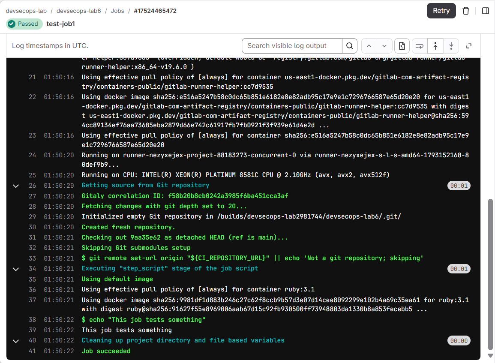
   *Hình 13: Nhật ký thực thi chi tiết (Job log) của công việc `test-job1`.*

---

## 4. NỘI DUNG THỰC HÀNH 6.2.2: TẠO PIPELINE CI/CD PHỨC TẠP VỚI DOCUSAURUS

### Bước 1: Tạo dự án trên GitLab và khởi tạo Docusaurus cục bộ
1. Tạo một dự án trống mới trên GitLab với tên `lam-pipeline-tutorial-project` (`https://gitlab.com/devsecops-lab2981744/lam-pipeline-tutorial-project.git`).

   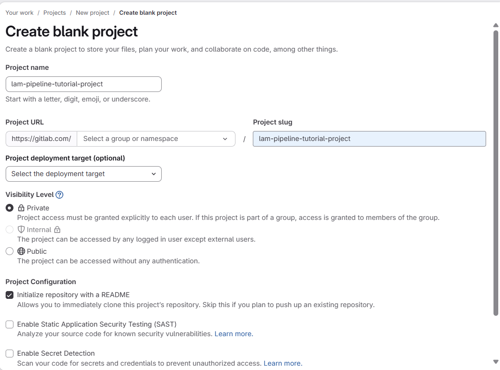
   *Hình 14: Khởi tạo dự án `lam-pipeline-tutorial-project` trên GitLab.*

2. Khởi tạo trang web **Docusaurus** tại thư mục gốc của dự án và cấu hình `docusaurus.config.js`:
   - Đặt `url: 'https://devsecops-lab2981744.gitlab.io/'`
   - Đặt `baseUrl: '/lam-pipeline-tutorial-project/'`
   - Thực hiện commit và đẩy toàn bộ mã nguồn Docusaurus lên nhánh `main` của kho lưu trữ GitLab:
     ```bash
     git remote add origin https://gitlab.com/devsecops-lab2981744/lam-pipeline-tutorial-project.git
     git branch -M main
     git add .
     git commit -m "Add simple generated Docusaurus site"
     git push -uf origin main
     ```

   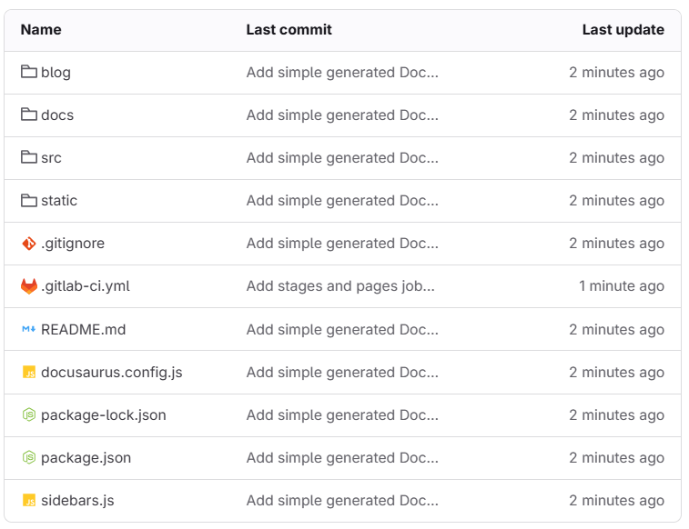
   *Hình 15: Mã nguồn dự án Docusaurus và tệp `.gitlab-ci.yml` sau khi đẩy lên kho lưu trữ GitLab.*

---

### Bước 2: Xây dựng và nâng cấp cấu hình `.gitlab-ci.yml` qua 3 giai đoạn
1. **Cấu hình CI/CD ban đầu (`test-job`):** Kiểm tra kích hoạt runner với lệnh in thông báo và ngày giờ (`Add initial CI/CD configuration...` - Pipeline `#2997198896`).
2. **Thêm job đóng gói trang web (`build-job`):** Sử dụng Docker image `node` để chạy `npm install`, `npm run build` và lưu thư mục `build/` vào `artifacts` (`Replace test-job with build-job` - Pipeline `#2997199307`).
3. **Thêm job triển khai lên GitLab Pages (`pages`):** Định nghĩa 2 giai đoạn `build` và `deploy`, chuyển thư mục `build/` từ `artifacts` sang `public/` để triển khai tự động lên GitLab Pages (`Add stages and pages job to deploy...` - Pipeline `#2997199549`):

   ```yaml
   stages:
     - build
     - deploy

   build-job:
     stage: build
     image: node
     script:
       - npm install
       - npm run build
     artifacts:
       paths:
         - "build/"

   pages:
     stage: deploy
     script:
       - mv build/ public/
     artifacts:
       paths:
         - "public/"
   ```

   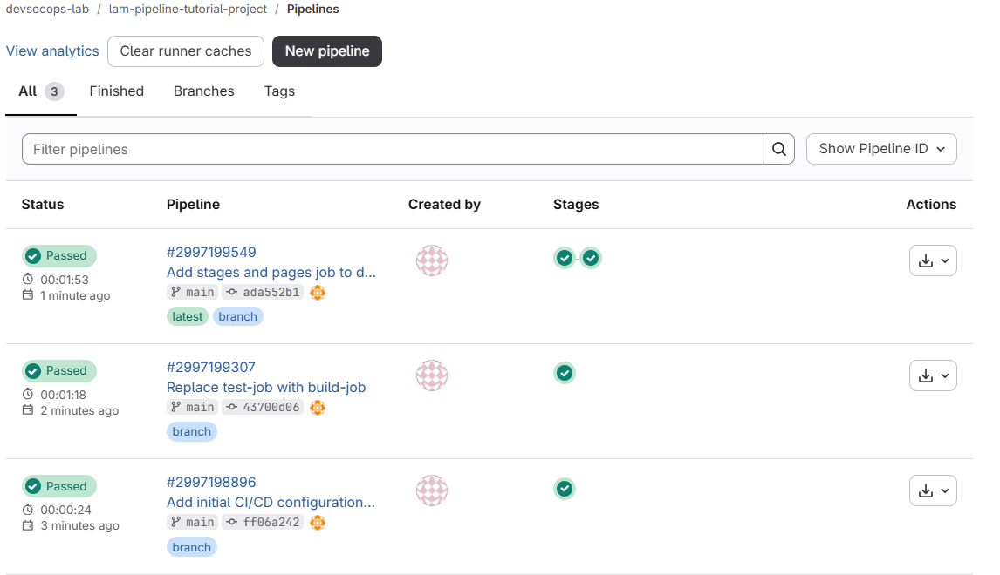
   *Hình 16: Cả 3 lần nâng cấp cấu hình Pipeline (`#2997198896`, `#2997199307`, `#2997199549`) đều vượt qua thành công (`Passed`).*

---

### Bước 3: Truy cập trang web Docusaurus được triển khai trên GitLab Pages
- Sau khi job `pages` và `pages:deploy` hoàn tất, truy cập vào **Deploy > Pages** và mở đường dẫn trang web được cấp bởi GitLab Pages (`https://lam-pipeline-tutorial-project-38f8b1.gitlab.io`).
- Trang web tĩnh **Docusaurus (`My Site - Dinosaurs are cool`)** hiển thị đầy đủ giao diện, thanh điều hướng (`Tutorial`, `Blog`) và các thành phần React.

   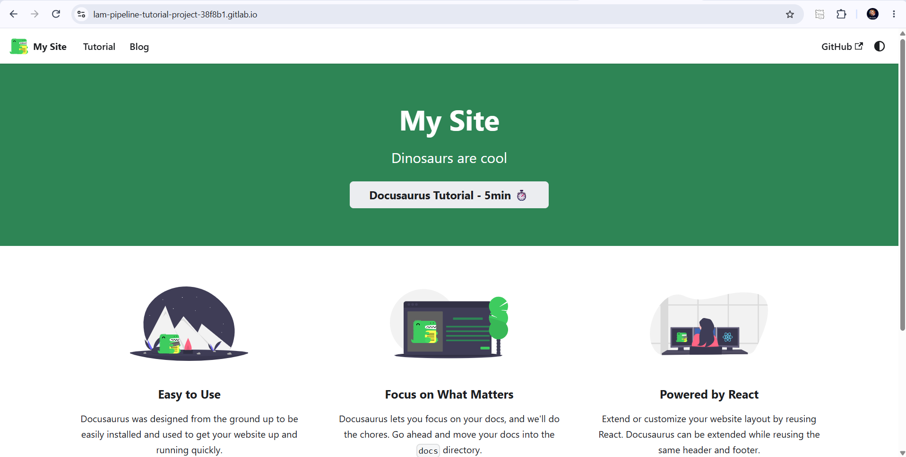
   *Hình 17: Truy cập thành công trang web Docusaurus sau khi triển khai tự động qua GitLab Pages.*

---


